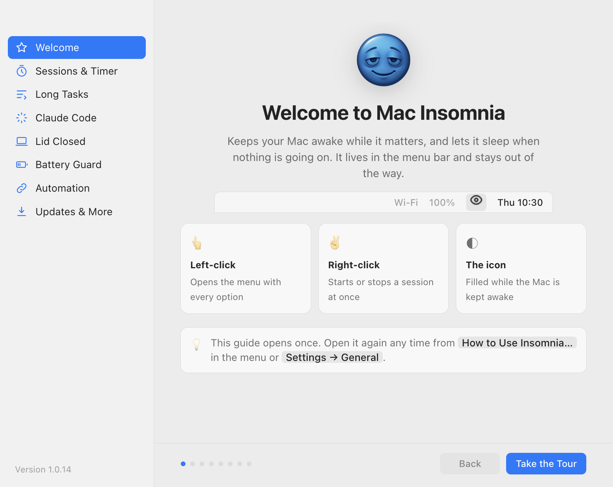
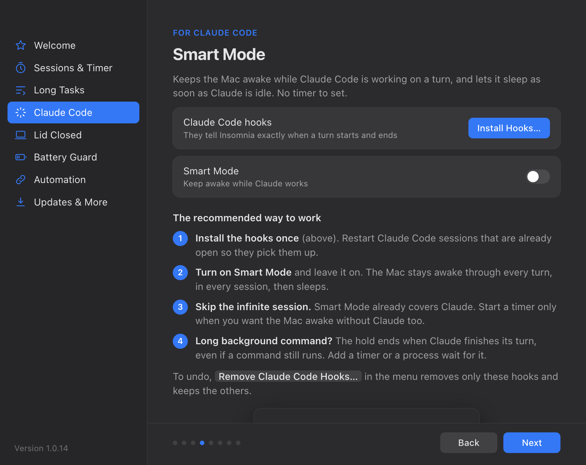
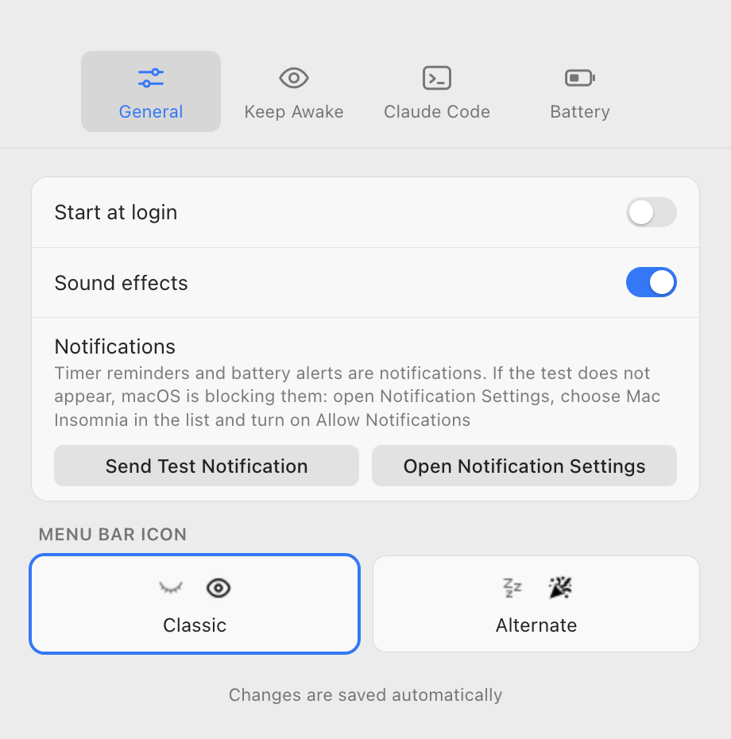
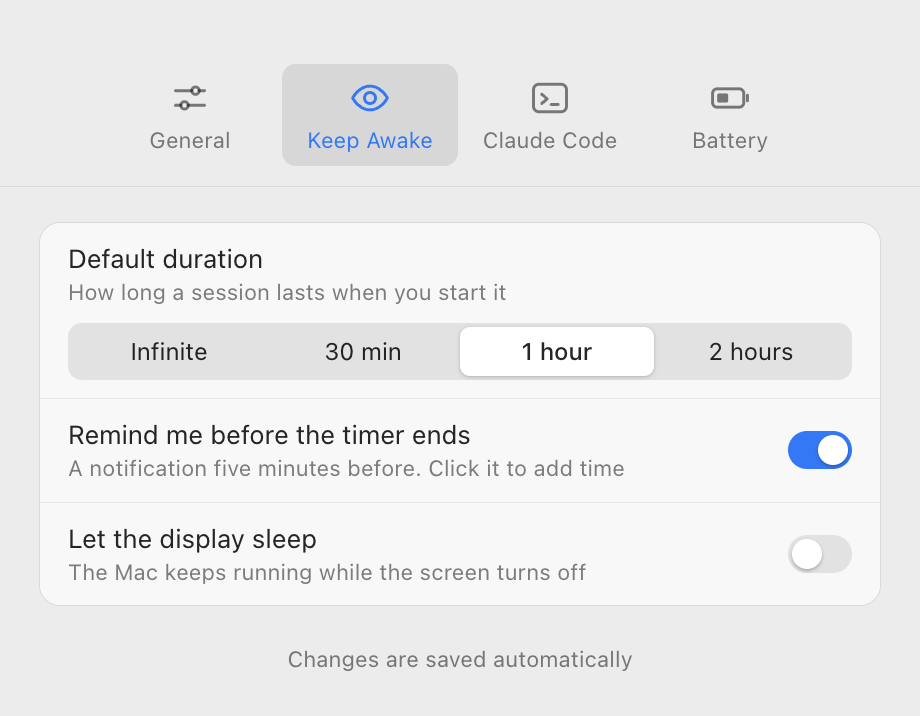
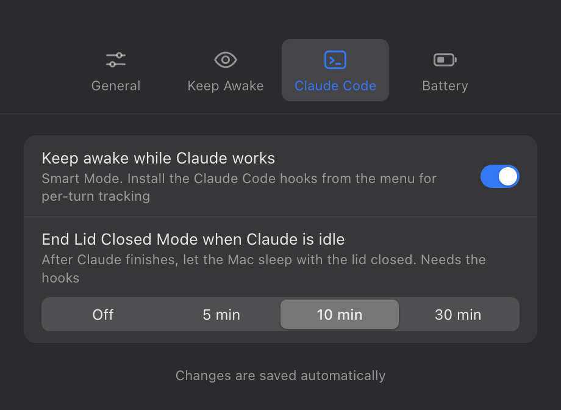
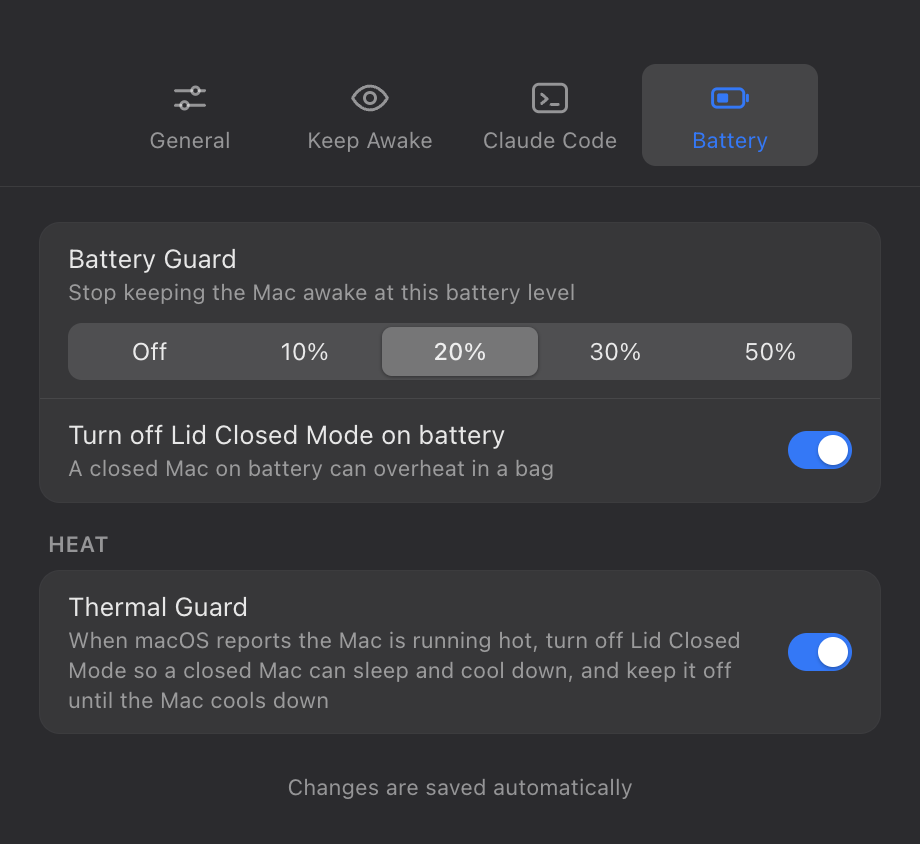
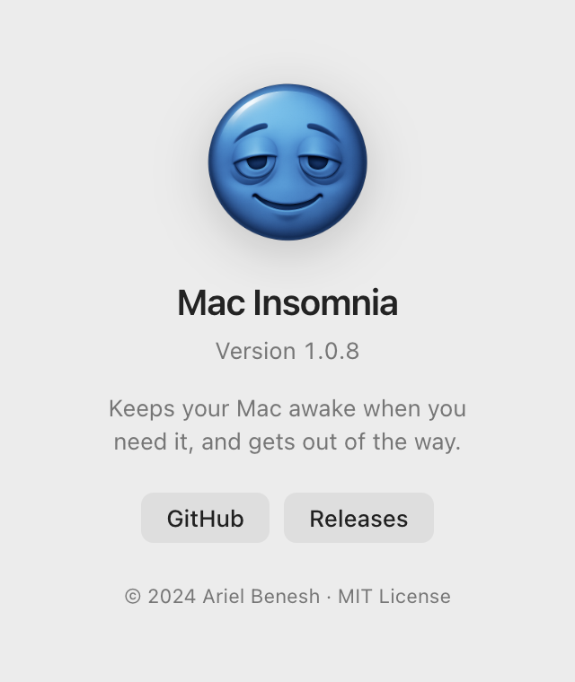
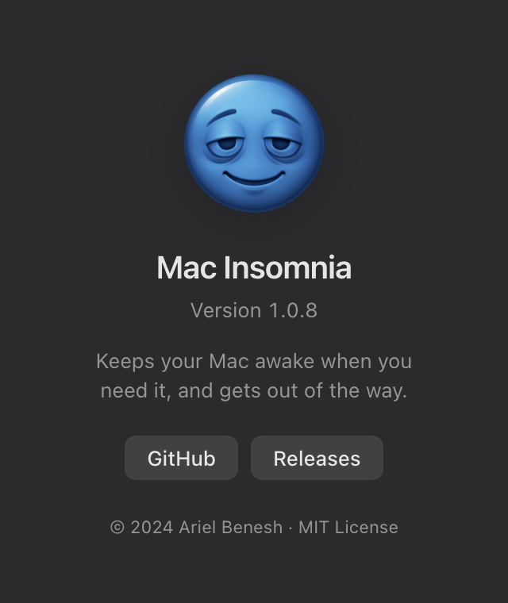

<p align="center">
  
</p>

<h1 align="center">💤 Mac Insomnia</h1>

[](https://opensource.org/licenses/MIT) [](https://github.com/relbns/mac-insomnia/actions/workflows/release.yml) [](https://github.com/relbns/mac-insomnia/releases) [](https://github.com/relbns/mac-insomnia/releases/latest)

<p align="center">
  A minimalist macOS utility that keeps your Mac awake when you need it most.<br>
  Perfect for long rendering sessions, file uploads, or coding marathons.
</p>

---

## 📸 Screenshots

| Guide, light | Guide, dark |
|---|---|
|  |  |

| General | Keep Awake |
|---|---|
|  |  |

| Claude Code | Battery |
|---|---|
|  |  |

| About, light | About, dark |
|---|---|
|  |  |

Settings is split into tabs and the window resizes to each one. The windows follow the system's light or dark appearance and accent color, and in the app the window background is translucent.

---

## 🚀 Features

- 🕹️ **Menu Bar Control** – Toggle sleep prevention instantly
- 📖 **Built-in Guide** – Opens on first launch and explains every option and the recommended way to work, with or without Claude Code. Open it again from **How to Use Insomnia…** in the menu or **Settings → General**
- ⏱️ **Set Duration** – Choose 30 min, 1 hour, 2 hours, or infinite
- ⏰ **Timer Reminder** – A notification five minutes before the timer ends. Clicking it opens the menu, where **Add 30 Minutes** extends the session
- 🔋 **Battery Guard** – Stops keeping the Mac awake when the battery runs low (20% by default), and turns off Lid Closed Mode on battery
- ⏳ **Keep Awake Until a Process Ends** – Pick a busy app or tool (a build, a render, a download) and stay awake until it finishes, with a notification when it does
- 🖥️ **Let the Display Sleep** – Keep the Mac running but let the screen turn off, to save power during downloads, builds or long Claude runs
- 🔊 **Sound Effects** – Optional feedback for start/stop
- 🧠 **Start at Login** – Launch automatically with macOS
- 🧩 **Icon Sets** – Switch between two icon styles
- 💻 **Lid Closed Mode** – Keep the Mac running with the lid closed (asks for an admin password)
- 🤖 **Smart Mode for Claude Code** – Stay awake only while Claude is working
- ⚡ **Automation** – `mac-insomnia://start?minutes=90` links for Shortcuts, Raycast and scripts
- 💤 **Powered by `caffeinate`** – Lightweight native macOS approach
- 🪶 **Light at idle** – One process, about 30 MB of memory, no polling and no idle wakeups
- 🔄 **Self-updating** – Checks GitHub Releases daily and installs an integrity-checked update when you confirm
- 🔒 **Hardened** – Settings and About run with context isolation and the renderer sandbox, and the Electron fuses that let the app run as plain Node (`ELECTRON_RUN_AS_NODE`, `NODE_OPTIONS`, `--inspect`) are off

---

## 🧩 Installation

1. Download the latest `.dmg` from the [Releases page](https://github.com/relbns/mac-insomnia/releases).
2. Drag **Mac Insomnia.app** into your **Applications** folder.
3. The app is ad-hoc signed but not signed with an Apple Developer ID or notarized, so macOS blocks it the first time when it was downloaded in a browser. Allow it once in **System Settings → Privacy & Security → Open Anyway**, or run:

   ```bash
   xattr -dr com.apple.quarantine "/Applications/Mac Insomnia.app"
   ```

4. Launch it from Spotlight. It lives in the menu bar: left-click for the menu, right-click to start or stop. The guide opens on the first launch.
5. When macOS asks whether Mac Insomnia may send notifications, choose **Allow**: timer reminders and battery alerts are notifications. If you missed that prompt, open **Settings → General → Notifications** in Mac Insomnia, press **Send Test Notification**, and if nothing appears, press **Open Notification Settings**, choose **Mac Insomnia** in the list and turn on **Allow Notifications**.

---

## 🔄 Updates

Mac Insomnia checks GitHub Releases once a day (Settings → General → **Check for updates automatically**, or **Check for Updates…** in the menu). When a new version is out, a notification offers to install it, and nothing installs until you confirm.

- The update is downloaded from that version's release, and its SHA-512 checksum and size are compared with the release's `latest-mac.yml`.
- The app inside is checked for the right bundle id and version, and `codesign --verify --deep --strict` must pass. The app is ad-hoc signed, so these checks prove the download is intact and complete, not who built it: the trust rests on the GitHub release itself.
- The new copy is staged next to the app first. The swap is two renames, and the old copy is put back if either fails. Mac Insomnia then restarts, a running session and any process waits continue, and a notification says whether the update went in.
- If any check fails, nothing is changed. Updates are not offered while Lid Closed Mode is on, because it needs the administrator password to come back.
- Self-update arrived in 1.0.14. On an older version, install the latest release by hand once, as in [Installation](#-installation), and every later version updates itself.

---

## 🗑️ Uninstall

1. If you installed the Claude Code hooks, choose **Remove Claude Code Hooks…** in the menu. Hooks left behind do nothing, because each one checks that Mac Insomnia is running first, but removing them keeps `~/.claude/settings.json` clean.
2. Turn off **Start at Login** (Settings → General) and **Keep Awake with Lid Closed** if it is on, then quit Mac Insomnia.
3. Delete **Mac Insomnia.app** from **Applications**.
4. Optionally, delete what it leaves behind:

   ```bash
   rm -rf ~/Library/Application\ Support/mac-insomnia
   rm -f ~/.claude/settings.json.bak-mac-insomnia
   ```

   Mac Insomnia's entry under **System Settings → Notifications** goes away once macOS notices the app is gone, or you can turn it off there.

---

## ⚙️ Development

```bash
git clone https://github.com/relbns/mac-insomnia.git
cd mac-insomnia
npm install
npm start
npm test
```

---

## 🏗️ Build for macOS

```bash
npm run build
```

The generated `.dmg` will appear in:

```
dist/
```

### Releasing

1. Bump the version: `npm version 1.0.8 --no-git-tag-version`, then merge it to `master` through a PR.
2. Tag the merge commit and push the tag: `git tag -a v1.0.8 -m "1.0.8" && git push origin v1.0.8`.
3. `.github/workflows/release.yml` runs the tests, builds the `.dmg` and publishes the GitHub release with the workflow's own `GITHUB_TOKEN`. No secret is needed.

---

## 💻 Lid Closed Mode

`caffeinate` cannot stop the sleep that happens when you close a MacBook's lid. **Keep Awake with Lid Closed** in the menu runs `pmset -a disablesleep 1` through the standard macOS administrator prompt.

- **Use it only on power, and never put the Mac in a bag or a closed space while it is on.** The Mac will not sleep and can overheat. The app warns you before every activation and notifies you if the Mac switches to battery.
- Normal sleep (`disablesleep 0`) is restored when you turn the mode off, when the timer ends and when you quit, with no second password. The same administrator prompt starts a one-shot root launchd job that waits on a helper process tied to the app. When the helper ends, for any reason including a crash or a force quit, the job restores sleep and removes itself.
- On launch the app checks `pmset -g`. If sleep is still disabled after an unclean exit (for example a reboot while the mode was on), it asks for the password to restore it. If something else disabled sleep, the menu says so and offers **Restore Normal Sleep…**.
- The mode always starts off when the app launches.

---

## 🔋 Battery Guard

**Battery Guard** in the menu stops everything that keeps the Mac awake when the battery reaches the level you pick (10, 20, 30 or 50%, 20% by default, or Off):
- the session;
- Lid Closed Mode;
- Smart Mode holds. Smart Mode resumes on its own when power is connected.

A notification says when it does.

- The level is checked with `pmset -g pslog`, a stream of the system's power-source notifications, so Mac Insomnia does not poll. That stream runs only while the guard is on, the Mac is on battery and something is keeping it awake.
- **Turn Off Lid Closed Mode on Battery** (on by default) keeps Lid Closed Mode off whenever the Mac runs on battery, because a closed Mac running on battery is the case where it can overheat in a bag. It turns the mode off when the Mac switches to battery, even while the password prompt is open, and refuses to turn it on while on battery. With it off, you get a warning instead.
- Starting a session below the guard level stops it again right away, with the same notification. Lower the level or set it to Off to override. That also resumes a paused Smart Mode.

---

## ⚡ Automation (Shortcuts, Raycast, scripts)

Mac Insomnia handles `mac-insomnia://` links, so anything that can open a URL can control it:

| Link | Does |
|---|---|
| `mac-insomnia://start` | Starts with the current duration |
| `mac-insomnia://start?minutes=90` | Starts for 90 minutes (1 to 1440). If already running, restarts the timer |
| `mac-insomnia://start?minutes=infinite` | Starts with no time limit |
| `mac-insomnia://stop` | Stops |
| `mac-insomnia://toggle` | Starts or stops |
| `mac-insomnia://until?pid=1234` | Keeps the Mac awake until process 1234 ends, then notifies |

- **Terminal or scripts:** `open -g "mac-insomnia://start?minutes=90"` (`-g` keeps focus where it is). The link launches Mac Insomnia if it is not running.
- **Shortcuts:** add an **Open URLs** action with one of the links.
- **Raycast:** create a Quicklink with one of the links.

To keep the Mac awake for exactly as long as a command runs, start it in the background and hand its pid to Insomnia:

```bash
npm run build & open -g "mac-insomnia://until?pid=$!"
```

The command then runs in the background, so stop it with `kill %1` rather than Ctrl-C. Inside a script, `open -g "mac-insomnia://until?pid=$$"` waits for the script itself.

Waiting for a process is separate from the session: **Stop Insomnia** and `mac-insomnia://stop` leave it running, and **Stop Waiting for …** in the menu ends it. A wait renews itself every 24 hours while the process runs, and a wait left behind by a crash of Mac Insomnia is cleared on its next launch.

Lid Closed Mode cannot be turned on from a link, because it needs the warning and the administrator prompt.

---

## 🤖 Smart Mode for Claude Code

**Smart Mode: Keep Awake While Claude Works** in the menu keeps the Mac awake while Claude Code is working, and lets it sleep when Claude is idle.

- **With hooks (recommended).** Choose **Install Claude Code Hooks…** in the menu. This adds hooks to `~/.claude/settings.json` and saves a backup next to it (`settings.json.bak-mac-insomnia`).
  - `UserPromptSubmit` marks a session busy.
  - `Stop`, `StopFailure`, `SessionEnd` and the `idle_prompt` notification mark it idle.
  - Each hook runs `open -g "mac-insomnia://claude?state=busy|idle&pid=$PPID"` in the background, and only while Mac Insomnia is running. A prompt never waits for it, and quitting the app keeps it quit.
  - Sessions that are already open pick up the hooks after a restart.
- **Without hooks.** Mac Insomnia checks every 30 seconds for running Claude Code processes (the native `claude` binary or the npm CLI), and keeps the Mac awake while any exists. An idle session that stays open, for example in VS Code, counts as running.
- **How a session is held.** Each session is held by `caffeinate -i -s -t 10793 -w <claude pid>`. The hold ends at the first of these:
  - the session goes idle;
  - its Claude process exits;
  - 3 hours pass since the last prompt.

  The cap covers a turn that ends without an idle event. The display may still sleep. Holds left behind by a crash of Mac Insomnia are cleared on its next launch.
- **Background work.** The hold ends when Claude finishes its turn, even if it left a background command running. For long background runs, use the normal timer as well.
- **End Lid Closed Mode when Claude is idle** (Settings → Claude Code, 10 minutes by default, or 5, 30 or Off). Turn on Lid Closed Mode, close the lid and let Claude work. Once Claude has worked and then finished, and no session has worked for that long, Insomnia turns Lid Closed Mode off, so a closed Mac can sleep instead of staying awake in a bag for hours. If you had an Insomnia session running before you turned on Lid Closed Mode, that session keeps running. If Lid Closed Mode started the session, it ends too.
  - The countdown starts only after Claude has been seen working during this Lid Closed Mode session, so a download or build with no Claude involved is never cut short. It resets when Claude works again, and changing the setting keeps the time already counted.
  - A session counts as finished on its idle event or when its Claude process exits, never when its 3-hour hold cap runs out. It needs the hooks: sessions that were open before the hooks were installed send no events until they restart.
- **Remove Claude Code Hooks…** removes only these hooks and keeps every other hook, including one that shares a group with them.

---

## 📊 Resource use

Measure any running instance with:

```bash
npm run measure -- --pid <main process pid> --minutes 30 --out result.json
```

It samples RSS and CPU time of the app and every child process, and reports the RSS growth rate and idle wakeups.

---

## 📦 Tech Stack

- [Electron](https://www.electronjs.org/)
- [Node.js](https://nodejs.org/)
- Native macOS `caffeinate` command

---

## 🪪 License

This project is licensed under the [MIT License](LICENSE).

---

<p align="center">
  <sub>Built by @relbns for macOS users</sub>
</p>
